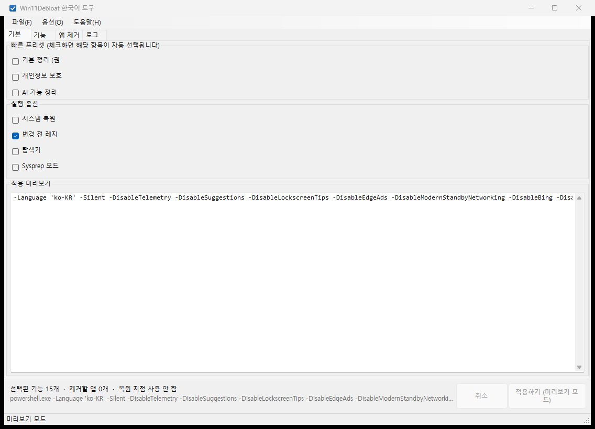
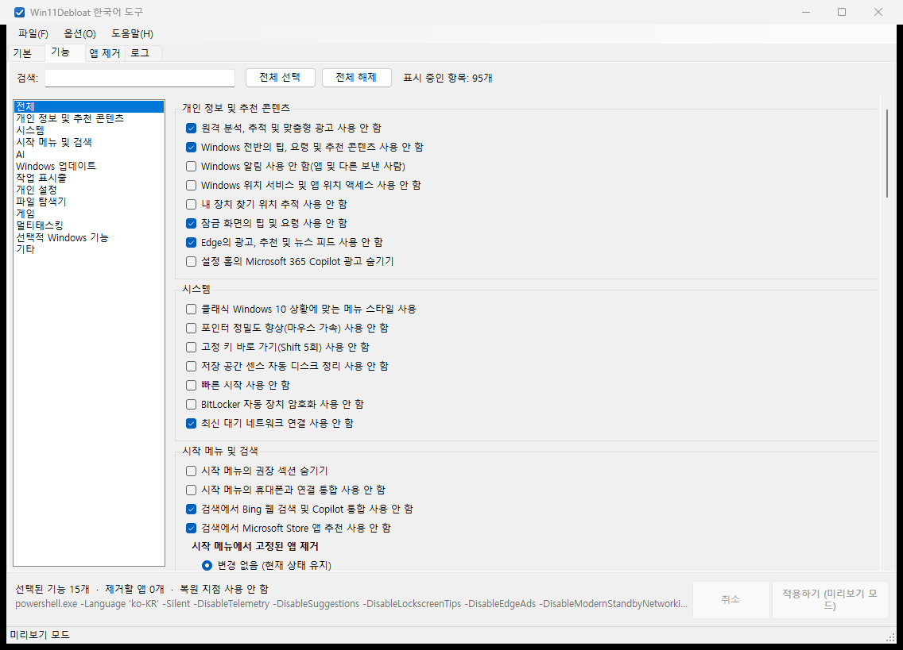
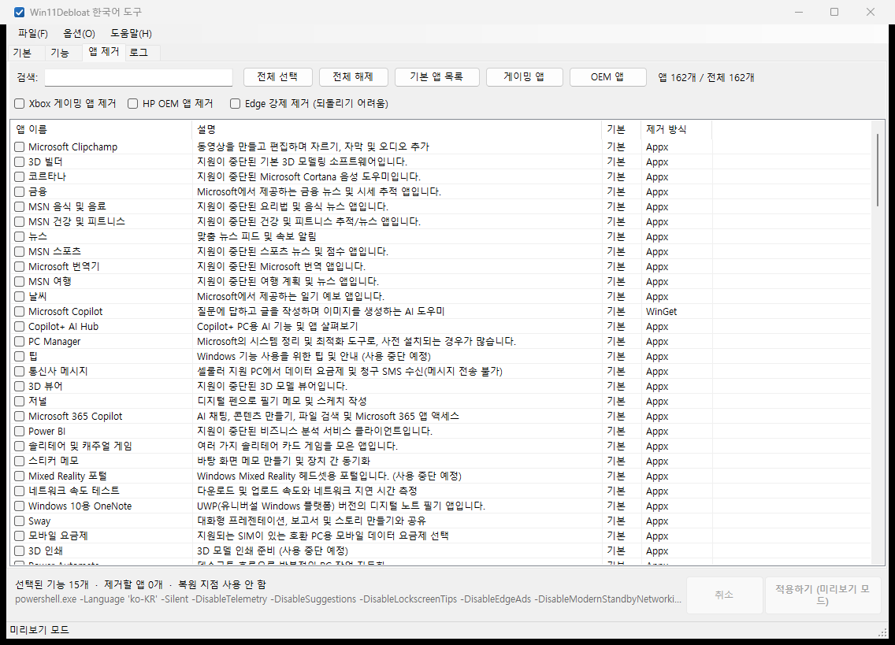
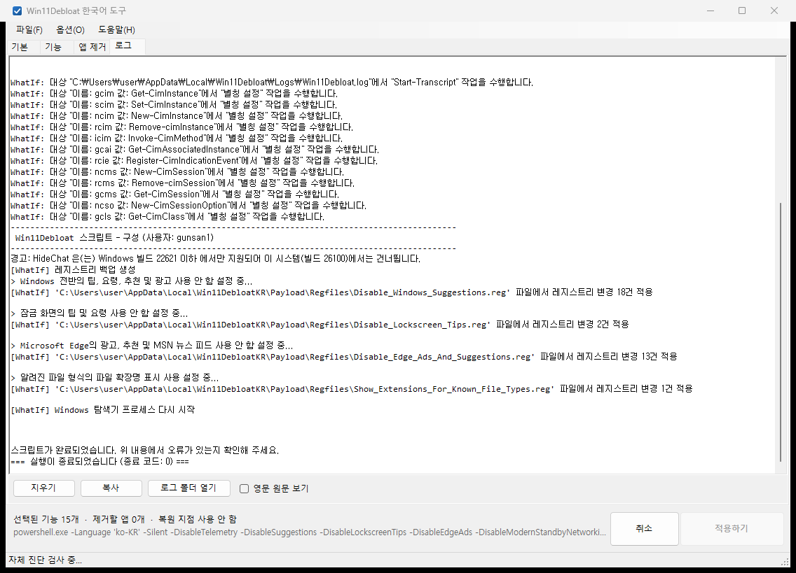

# 🧹 Win11DebloatKR — win11debloat 한국어 GUI 실행 파일

[github.com/raphire/win11debloat](https://github.com/raphire/win11debloat) 을 **Git 에서 직접 클론**해
소스 기준으로 작업한, **전체 메뉴가 한국어인 단일 exe 실행 파일**입니다.

> upstream 의 WPF GUI 를 재구현하는 대신, upstream 이 그대로 배포하는 CLI 엔진
> (`Win11Debloat.ps1`) 을 구동하는 **네이티브 C# WinForms 래퍼**로 만들었습니다.
> 덕분에 기능/앱 목록은 upstream 의 `Config/Languages/ko-KR` 카탈로그에서 직접 읽어
> **upstream 과 자동으로 동기화**되고, 실제 적용 로직도 upstream 과 100% 동일합니다.

| 항목 | 내용 |
|---|---|
| 📦 산출물 | `build\Win11DebloatKR.exe` (단일 파일, 약 0.82 MB) |
| 🔗 원본 | https://github.com/raphire/win11debloat (MIT) |
| 📌 기준 커밋 | `ea20885` (branch `master`) |
| 🖥️ 런타임 | Windows 10/11 · .NET Framework 4.7.2 이상 · Windows PowerShell 5.1 (기본 포함) |
| 🔑 권한 | 실제 적용 시 관리자 권한 필요 (실행 시 자동 승격) |

---

## 🚀 1. 빠른 시작

```
build\Win11DebloatKR.exe
```

1. ✨ exe 를 더블클릭하면 관리자 권한 승격 창이 뜹니다 → **예**.
2. 🗂️ 상단 탭에서 원하는 항목을 고릅니다.
   - 🏠 `기본` — 프리셋(추천/기본/최소) · 대상 사용자 · 실행 옵션
   - ⚙️ `기능` — 12개 분류 / 103개 기능 / 10개 그룹
   - 🗑️ `앱 제거` — 162개 앱 중 제거 대상 선택
   - 📋 `로그` — 진행 상황과 결과
3. ✅ 하단 `적용하기` 를 누르면 실제 변경이 적용되고, 결과는 `로그` 탭에 표시됩니다.

> 💡 exe 하나만 옮기면 됩니다. 내장된 스크립트는 최초 실행 시
> `%LOCALAPPDATA%\Win11DebloatKR\Payload` 로 풀려서 사용되며(외부 설치 불필요),
> 두 번째 실행부터는 해시 비교 후 그대로 재사용합니다.

### ⚙️ 실행 옵션

| 옵션 | 설명 |
|---|---|
| *(없음)* | 관리자 권한으로 승격 후 GUI 실행 |
| 👁️ `--preview` | 권한 승격 없이 UI 만 확인 (적용 버튼 비활성) |
| 🩺 `--selftest` | **시스템을 바꾸지 않는** 자체 진단. `-WhatIf` 로 실제 적용 파이프라인을 검증 |
| 🔢 `--tab=N` | 시작 시 지정 탭 표시 (0=기본, 1=기능, 2=앱 제거, 3=로그) |

```powershell
# 예: 권한 없이 화면만 확인
.\build\Win11DebloatKR.exe --preview --tab=1
```

---

## 🗂️ 2. 탭별 사용법

### 🏠 기본 탭
- 🎯 **프리셋**: 추천(기본) / 기본 / 최소 중 선택. 프리셋을 고르면 `기능` 탭의 선택이 함께 맞춰집니다.
- 👤 **대상 사용자**: 현재 사용자 / 다른 사용자 / 모든 사용자.
- ⚙️ **실행 옵션**: 시스템 복원 지점 만들기, 레지스트리 백업 건너뛰기, 탐색기 재시작 여부.



### ⚙️ 기능 탭
- 🗂️ 좌측 분류(12개) → 중앙 기능 목록 → 우측 그룹(라디오) 선택.
- 🔘 그룹(라디오) 항목은 upstream 규칙대로 **"변경 없음"이 기본 선택**이며, 이 상태에서는
  해당 스위치를 CLI 에 넘기지 않습니다. 즉 기본값 그대로 두면 아무것도 바뀌지 않습니다.
- 🏷️ `'(기본값)'` 이 붙은 옵션은 사용자가 직접 선택해야 실제 스위치로 적용됩니다.



### 🗑️ 앱 제거 탭
- 📋 162개 앱 목록에서 제거 대상을 체크합니다. 🔍 검색어로 필터링할 수 있습니다.
- 📦 여러 패키지로 이루어진 앱(예: Microsoft PC Manager, Edge)은 패키지 ID 전체가 함께 제거됩니다.
- 🛠️ 제거 방식이 Appx 가 아닌 앱은 `winget` 이 필요합니다.



### 📋 로그 탭
- 📡 진행 메시지와 오류를 실시간으로 표시합니다.
- 🧰 `지우기` / `복사` / `로그 폴더 열기` 버튼과 **👁️ `영문 원문 보기`** 체크박스(원문 대조용)가 있습니다.



---

## 🇰🇷 3. 한국어 처리 방식

upstream 의 ko-KR 언어 파일은 **Features / Apps / Categories / Chrome** 항목만 번역합니다.
그 밖의 출력은 영어로 나오는 부분을 세 겹으로 보완했습니다.

1. 🖥️ **GUI 자체** — 창 제목, 메뉴, 탭, 버튼, 라벨, 도움말, 상태 표시줄까지 전부 한국어
   (`src/MainForm.cs`). 문자열 리소스를 별도 파일로 분리하지 않고 코드에 두어
   단일 exe 빌드를 유지했습니다.
2. 📦 **payload 카탈로그 병합** — 빌드 시 payload 의 `Config/Features.json` 표시 전용 필드
   (`Label`, `ApplyText`, `UndoLabel`, `ApplyUndoText`, `ToolTip`)를 ko-KR 값으로 덮어씁니다.
   upstream 의 CLI 엔진은 이 파일을 읽어 진행 메시지를 출력하므로,
   `> Disabling tips, tricks...` → `> Windows 전체의 팁, 트릭, 추천 및 광고 사용 안 함 설정 중...`
   처럼 콘솔까지 한글이 됩니다.
   - 🔒 분류/그룹 **링크 키**(`Category`, `GroupId`, 그룹 옵션 `Label`)는 건드리지 않습니다.
     upstream 이 이 값들을 매칭 키로 쓰고, `(Default)` 판정도 이 값에 의존하기 때문입니다.
   - ⚠️ 병합된 파일은 **UTF-8 BOM** 으로 저장합니다. upstream 이 `Get-Content -Raw`(인코딩 지정 없음)로
     읽는데, Windows PowerShell 5.1 은 BOM 이 없으면 시스템 ANSI 코드페이지로 해석해
     JSON 파싱이 실패하기 때문입니다.
3. 🔤 **스크립트 하드코딩 문장 번역** — 배너·경고·진행 메시지 등 언어 파일과 무관하게 영문인
   문장을 `src/ConsoleTranslator.cs` 의 정규식 규칙 104개로 번역합니다.
   규칙에 맞지 않는 줄은 **원문 그대로** 남기므로 오류 내용이 사라지지 않습니다.
   (`tools\TranslatorTest.cs` 로 45개 케이스 단위 검증 — ✅ 전부 통과)

> 👁️ `영문 원문 보기` 체크박스를 켜면 번역 없이 원래 영문 메시지를 볼 수 있습니다.

### 🔤 ko-KR 카탈로그 보정 사항
`tools/patch-ko-kr.ps1` 로 upstream 의 ko-KR 카탈로그 13건을 보정했습니다
(누락 키는 0건이며 stale 값 1건 + MS 제품명 표기 12건).

| 원본 | 수정 |
|---|---|
| Xbox Speech To Text (stale 값) | 게임 음성 창 |
| Microsoft Store | Microsoft 스토어 |
| Game Bar | 게임 바 |
| Xbox Console Companion | Xbox 콘솔 컴패니언 |
| Windows App | Windows 앱 |
| Solitaire & Casual Games | 솔리테어 및 캐주얼 게임 |
| Cortana | 코르타나 |
| 3D Builder | 3D 빌더 |
| Network Speed Test | 네트워크 속도 테스트 |
| OneNote for Windows 10 | Windows 10용 OneNote |
| One Calendar | One 일정 |
| Xbox Game Overlay | Xbox 게임 오버레이 |
| Xbox Identity Provider | Xbox ID 공급자 |

---

## 🔨 4. 직접 빌드하기

```powershell
# 빌드만 하면 끝입니다. upstream 원본이 없으면 자동으로 클론하고,
# ko-KR 카탈로그 보정도 자동으로 적용합니다.
pwsh -File .\build.ps1
```

`build.ps1` 이 하는 일:

1. 📥 `win11debloat` 원본이 없으면 `git clone --depth 1` 로 자동 확보합니다.
   (이 저장소에는 upstream 사본을 올리지 않습니다.)
2. 🔤 `tools/patch-ko-kr.ps1` 로 ko-KR 카탈로그 보정을 적용합니다. 이미 적용돼 있으면 건너뛰므로
   반복 실행해도 안전합니다.
3. 📦 `win11debloat` 실행 트리(`Config`/`Scripts`/`Regfiles`/`Assets`/`Schemas` + `Win11Debloat.ps1`)를
   `payload.zip` 으로 묶음.
4. 🇰🇷 ko-KR 카탈로그를 payload 의 `Config/Features.json` 에 병합 (`tools/merge-ko-kr-features.ps1`).
5. 🎨 다중 크기 `.ico` 생성.
6. ⚙️ Roslyn `csc` 로 **단일 exe** 컴파일 (`payload.zip` 과 아이콘은 리소스로 내장).

수동으로 원본을 따로 준비하려면:

```powershell
git clone --depth 1 https://github.com/raphire/win11debloat.git .\win11debloat
pwsh -File .\tools\patch-ko-kr.ps1
pwsh -File .\build.ps1
```

### 🧰 필요 도구
- 🛠️ Visual Studio(또는 Build Tools)의 Roslyn `csc.exe`
  (`C:\Program Files\Microsoft Visual Studio\...\MSBuild\Current\Bin\Roslyn\csc.exe`)
- 📚 .NET Framework 4.7.2 이상 참조 어셈블리
- 🐚 PowerShell 7 (pwsh) — 빌드 스크립트 실행용

---

## 📁 5. 폴더 구조

```
win11-debloater/
├─ .gitignore                      # upstream 사본·재생성 가능한 산출물 제외
├─ build.ps1                       # 빌드 스크립트 (단일 exe 생성)
├─ build/
│  ├─ Win11DebloatKR.exe           # ★ 최종 산출물
│  ├─ payload.zip                  # 내장 스크립트 묶음 (빌드 시 생성)
│  └─ appicon.ico                  # 빌드 시 생성
├─ src/                            # C# GUI 소스
│  ├─ Program.cs                   # 진입점, 단일 인스턴스, 관리자 승격, CLI 옵션
│  ├─ MainForm.cs                  # 4탭 GUI 전체
│  ├─ Catalog.cs                   # Config/카탈로그 로딩 + 한국어 병합
│  ├─ Runner.cs                    # PowerShell 실행 + 실시간 출력
│  ├─ ConsoleTranslator.cs         # 스크립트 출력 영어 → 한국어 규칙
│  ├─ Payload.cs                   # 내장 리소스(payload.zip) 추출
│  ├─ AppIcon.cs
│  └─ AssemblyInfo.cs              # exe 파일 속성
├─ tools/
│  ├─ patch-ko-kr.ps1              # ko-KR 카탈로그 보정
│  ├─ merge-ko-kr-features.ps1     # payload Features.json 한국어 병합
│  ├─ capture.ps1                  # GUI 스크린샷 캡처(검증용)
│  ├─ test-translator.ps1          # 번역 규칙 단위 테스트 실행
│  └─ TranslatorTest.cs            # 번역 규칙 단위 검증
└─ win11debloat/                   # upstream 원본 (Git 미추적, 빌드 시 자동 클론)
```

---

## 🧾 6. 로그와 진단 파일

| 경로 | 내용 |
|---|---|
| 📦 `%LOCALAPPDATA%\Win11DebloatKR\Payload\` | 풀려 나온 내장 스크립트 |
| ❌ `%LOCALAPPDATA%\Win11DebloatKR\error.log` | GUI 예외 스택 |
| 📊 `%LOCALAPPDATA%\Win11DebloatKR\diagnose.txt` | 카탈로그/CLI 인자 통계 |
| 📝 `%LOCALAPPDATA%\Win11Debloat\Logs\Win11Debloat.log` | upstream 원본 실행 로그 |

---

## 🛡️ 7. 안전장치와 알려진 제약

- 🔒 **단일 인스턴스** — 중복 실행 방지(뮤텍스). 두 번째 실행은 안내 메시지만 표시합니다.
- 🔑 **관리자 권한** — 실제 적용에는 관리자 권한이 필요하며 실행 시 자동으로 승격합니다.
  `--preview` 는 승격하지 않습니다.
- 🩺 **WhatIf 자체 진단** — `--selftest` 는 `-WhatIf` 로 실제 적용 파이프라인을 그대로 돌리므로
  레지스트리/시스템에 아무 변화도 생기지 않습니다. (앱 제거·예약 작업 등 부수 효과가 있는
  기능은 `-WhatIf` 로도 실제 변경이 생길 수 있어 진단에서 제외했습니다.)
- 🔇 **`-WhatIf` 모드의 `Stop-Transcript` 잡음** — PowerShell 의 `Start-Transcript` 은 `-WhatIf` 에서
  수행되지 않는데 upstream 이 마지막에 `Stop-Transcript` 를 무조건 호출해
  "기록 중이 아닙니다" 오류가 납니다. 진단 실행에서만 `Stop-Transcript` 를 빈 함수로 대체해
  잡음을 제거했습니다. 실제 적용 모드에서는 기록이 정상적으로 끝나므로 건드리지 않습니다.
- 🐚 **PowerShell 5.1 고정** — upstream 은 PowerShell 7 을 지원하지 않으므로
  `C:\Windows\System32\WindowsPowerShell\v1.0\powershell.exe` 만 사용합니다.
  PowerShell 7 에서 실행된 프로그램은 `PSModulePath` 가 덮여써져 Windows PowerShell 5.1 의
  내장 모듈(`Appx`, `Security`)을 못 읽으므로, 자식 프로세스에 모듈 경로를 앞에 붙여 줍니다.
- 🚀 **명령 전달 방식** — `-EncodedCommand` 는 콘솔이 없는 GUI 프로세스에서 시작할 때
  "액세스가 거부됩니다"로 실패하므로, upstream 의 `Run.bat` 과 같은 `-Command` 방식으로 전달합니다.
- 🔤 **UTF-8 출력** — 자식 프로세스의 콘솔 인코딩을 UTF-8 로 맞추고 표준 출력을 UTF-8 로 디코딩합니다.
  `Clear-Host` 는 콘솔 없는 환경에서 예외를 던지므로 빈 함수로 대체합니다.

---

## 📜 8. 라이선스

upstream win11debloat 은 **MIT** 라이선스입니다. 이 래퍼도 같은 조건을 따릅니다.
원본 라이선스 전문은 `win11debloat\LICENSE` 에 있습니다.
